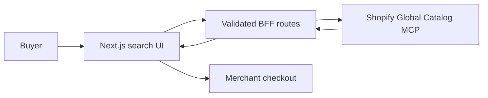

# Sift — Open Source Shopify Product Search Engine

[](https://sift-shopify-search.vercel.app)
[](https://nextjs.org/)
[](LICENSE)
[](https://ecorn.agency/)

Sift is an open source, buyer-first product search and comparison engine powered by [Shopify Global Catalog MCP](https://shopify.dev/docs/agents/catalog/global-catalog). It searches live products across eligible Shopify merchants, compares prices and variants, and sends shoppers directly to each store's checkout.

**[Try the live Shopify product search →](https://sift-shopify-search.vercel.app)**

## Features

- **Cross-store discovery:** Search Shopify's global catalog without crawling storefronts.
- **Live commerce data:** Compare current prices, availability, variants, ratings, and sellers.
- **Keyless MCP integration:** Basic catalog access requires an agent profile, not an API secret.
- **Buyer-first UX:** Filter results, inspect product options, and compare a shortlist.
- **Direct merchant checkout:** Preserve merchant ownership by handing buyers back to the store.
- **Production foundations:** Validation, rate guards, safe normalization, timeouts, and security headers.
- **Search-friendly:** Canonical metadata, Open Graph image, JSON-LD, sitemap, robots, and manifest.

## Architecture

Sift is a federated search interface, not a crawler or product database. Shopify owns catalog eligibility, product clustering, ranking, inventory, and offer freshness. Sift owns the search experience and a small server-side normalization boundary.



Read the full [architecture decision record](docs/ARCHITECTURE.md) and [product specification](docs/PRODUCT.md).

## Tech Stack

- Next.js 16 and React 19
- TypeScript and Zod
- Shopify Global Catalog MCP with UCP
- Vitest
- Vercel-compatible server routes

## Quick Start

Requirements: Node.js 20.9+ and npm.

```bash
git clone https://github.com/0gdao/sift-shopify-search.git
cd sift-shopify-search
npm install
cp .env.example .env.local
npm run dev
```

Open [http://localhost:3000](http://localhost:3000). Live catalog search works without Shopify API credentials.

## Configuration

| Variable | Required | Default | Purpose |
| --- | --- | --- | --- |
| `CATALOG_MODE` | No | `auto` | Use `live`/`auto` for Shopify or `mock` for demo data. |
| `NEXT_PUBLIC_SITE_URL` | No | Production demo URL | Canonical metadata, sitemap, and robots host. |
| `SHOPIFY_CATALOG_URL` | No | Shopify Global Catalog MCP | Restricted to HTTPS Shopify hosts. |
| `SHOPIFY_AGENT_PROFILE_URL` | No | Shopify's current public profile fixture | Public UCP capability profile; this is not a secret. |
| `SHOPIFY_SAVED_CATALOG_SLUG` | No | — | Optional saved catalog boundary. |

## Commands

```bash
npm test          # unit and contract tests
npm run typecheck # strict TypeScript checks
npm run build     # production Next.js build
```

See [TESTING.md](TESTING.md) for the full validation and browser QA checklist.

## API Routes

- `POST /api/catalog/search` — validate and execute a global product search.
- `POST /api/catalog/product` — retrieve current product and variant details.
- `GET /api/health` — report service health and active catalog mode.

Catalog results and product images are rendered in real time and are not cached, following Shopify's catalog usage rules.

## Deploy

Sift runs on any Node-compatible Next.js host. For Vercel, import the repository, keep the default build settings, and optionally set `NEXT_PUBLIC_SITE_URL` to your production domain.

[](https://vercel.com/new/clone?repository-url=https%3A%2F%2Fgithub.com%2F0gdao%2Fsift-shopify-search)

## Contributing

Issues and pull requests are welcome. Read [CONTRIBUTING.md](CONTRIBUTING.md), [SECURITY.md](SECURITY.md), and the [Code of Conduct](CODE_OF_CONDUCT.md) before contributing.

## License

Released under the [MIT License](LICENSE).

Built by [ECORN](https://ecorn.agency/).

## References

- [Shopify Global Catalog MCP](https://shopify.dev/docs/agents/catalog/global-catalog)
- [Shopify catalog interfaces and usage rules](https://shopify.dev/docs/agents/catalog)
- [Shopify agent profiles](https://shopify.dev/docs/agents/profiles)
- [Universal Commerce Protocol](https://ucp.dev/)
- [gstack](https://github.com/garrytan/gstack)
