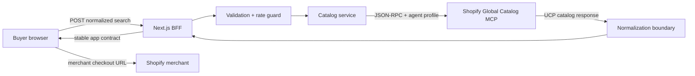

# Architecture

## Executive decision

Use Shopify Global Catalog MCP as the source of truth and build a server-rendered BFF around it. Do not crawl storefronts or replicate the global catalog. This gives live inventory and offer data, respects Shopify eligibility, and avoids an unbounded ingestion/compliance system.



## Runtime boundaries

### Browser

- Owns query state, filters, pagination, comparison shortlist, drawer state, and presentation.
- Never receives privileged Shopify credentials; product discovery is keyless.
- Treats catalog text and URLs as untrusted data and never renders product HTML.

### BFF routes

- `POST /api/catalog/search` validates the app request and invokes `search_catalog`.
- `POST /api/catalog/product` validates product ID/options and invokes `get_product`.
- `GET /api/health` reports service mode without exposing secrets.
- Applies a lightweight per-instance burst guard. Production multi-instance deployments should replace this with a shared edge limiter.

### Catalog service

- Calls `https://catalog.shopify.com/api/ucp/mcp` without an API key and includes an agent profile on every request.
- Preserves Shopify ranking and normalizes UCP/MCP shapes into a versioned app contract.
- Uses deterministic demo data only when `CATALOG_MODE=mock`; `auto` and `live` query Shopify.

## Search contract

App requests use decimal major-unit prices. The BFF converts them to Shopify minor units using the selected currency's ISO exponent.

```ts
type SearchInput = {
  query: string;
  cursor?: string;
  limit?: number;
  context?: { country?: string; currency?: string };
  filters?: {
    priceMin?: number;
    priceMax?: number;
    condition?: "new" | "secondhand";
    available?: boolean;
    ratingMin?: number;
  };
};
```

The public response is intentionally smaller and more stable than Shopify's upstream response. Unknown extension fields remain behind the normalization boundary.

## Failure design

| Failure | Behavior |
| --- | --- |
| Catalog timeout | 504 with retryable response |
| MCP or malformed response | 502; keep upstream details server-side |
| Rate burst | 429 plus `Retry-After` |
| No results | Preserve query and filters; offer broadening actions |
| Broken image | Product-specific deterministic fallback |
| Merchant URL absent | Disable merchant action instead of inventing a URL |

## Scale stages

1. **Now — single BFF:** Next.js server, instance-local burst guard, and direct keyless MCP calls.
2. **Traffic — shared control plane:** Redis rate limits and usage analytics. Catalog responses remain uncached per Shopify's usage rules.
3. **Revenue — transparent placements:** Add Shopify promoted placements only with disclosure, payout reconciliation, and separate organic/paid analytics.
4. **Personalization — explicit consent:** Add buyer-linked tokens when Shopify's personalized search is available. Isolate token storage and disable shared response caching.

## Protocol constraints that shape the product

- Search page size is 1–50; pagination depth is capped at 1,000 results.
- `total_count` is estimated, so the UI says “matches” and never calculates exact page counts.
- Availability defaults to sale-ready products.
- Prices are integer minor units upstream.
- Search results can cluster offers across merchants; `get_product` refines a product/variant selection.

## Security review

- Product discovery uses no API credentials; only the public agent profile URL is sent upstream.
- Catalog endpoint overrides must remain HTTPS Shopify hosts.
- Request bodies are schema-validated and size-bounded by field limits.
- Product descriptions are normalized to plain text; upstream HTML is never injected.
- External merchant links use `noopener noreferrer` and make the handoff explicit.
- Upstream calls have deadlines and return sanitized public errors.

## Test strategy

- Unit: validation, currency conversion, URL policy, and upstream normalization.
- Contract: keyless JSON-RPC request shape, agent profile metadata, and upstream errors with mocked fetch.
- Build: TypeScript plus production Next.js compilation.
- Browser QA: search, filters, pagination, drawer, shortlist, comparison, mobile layout, keyboard escape, and network/error states.
